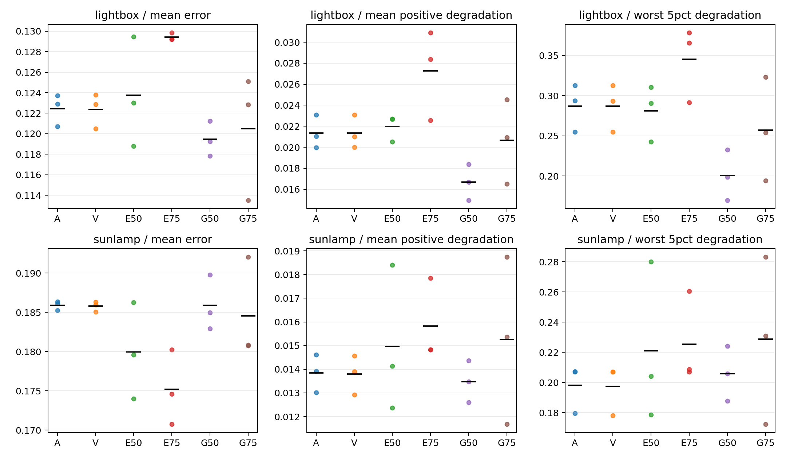

# 003几何门控：首轮探索结果

36次基础ODR、两域Offline开发评价和共享校准全部通过独立验收。三条观测流等权；本报告只使用已冻结开发GT，没有正式确认或预留集/全域评价。

结论：没有一档共享G阈值同时满足两域的预设风险方向，因此不执行条件性18次随机对照。G50在lightbox平均正退化降低21.93%、最严重5%退化均值降低30.19%；sunlamp平均正退化降低2.68%，但最严重5%退化均值增加3.96%。G75在sunlamp平均正退化增加10.21%、严重退化增加15.51%。两档G平均精度与覆盖约束均通过，未通过的是风险方向条件。

## 口径与有效分母

每域开发512张；固定参考I_ref由O/A可用预测确定，lightbox各流512、sunlamp各流511；最大5%取ceil(0.05*n)=26个D（包含零），D=max(E方法−EO,0)。混合E=hH旋转HIL项（rad）+hE归一化平移HIL项（m/m），为无量纲；另列旋转度数和平移米。
sunlamp的O仅511/512有有限H预测，适应方法为512/512；O在程序中相对A的coverage=False不属于方法筛选失败。该无效ID未进入任何方法的固定风险参考集，未用E替代H。原接受子集与完整有限预测另表保存，不能混为论文全域口径。

## 三流均值对照

| 域 | 方法 | 混合E | hH旋转(deg) | hE平移(m) | 平均正退化D | 最大5% D | 负迁移率 |
|---|---|---|---|---|---|---|---|
| lightbox | O | 0.147190795 | 6.631587438 | 0.176323230 | 0.000000000 | 0.000000000 | 0.000000000 |
| lightbox | A | 0.122431228 | 5.598220483 | 0.139793101 | 0.021353969 | 0.287019278 | 0.548177083 |
| lightbox | V | 0.122368903 | 5.594662674 | 0.139787755 | 0.021361402 | 0.287023135 | 0.547526042 |
| lightbox | E50 | 0.123755304 | 5.571212481 | 0.150780073 | 0.021959024 | 0.281254437 | 0.563151042 |
| lightbox | E75 | 0.129423007 | 5.819305360 | 0.157621449 | 0.027273769 | 0.345183126 | 0.590494792 |
| lightbox | G50 | 0.119450072 | 5.365522053 | 0.146918236 | 0.016670302 | 0.200377966 | 0.550781250 |
| lightbox | G75 | 0.120484605 | 5.422757205 | 0.146526151 | 0.020661228 | 0.257138018 | 0.565755208 |
| sunlamp | O | 0.222830883 | 10.731467500 | 0.211222649 | 0.000000000 | 0.000000000 | 0.000000000 |
| sunlamp | A | 0.185894473 | 8.951553528 | 0.178731469 | 0.013846503 | 0.198091440 | 0.435094586 |
| sunlamp | V | 0.185767550 | 8.944500671 | 0.178709210 | 0.013797996 | 0.197439002 | 0.434442270 |
| sunlamp | E50 | 0.179942748 | 8.647637207 | 0.171553867 | 0.014965064 | 0.220924185 | 0.386823222 |
| sunlamp | E75 | 0.175181731 | 8.441526463 | 0.166877255 | 0.015831184 | 0.225455339 | 0.395303327 |
| sunlamp | G50 | 0.185877408 | 8.940735693 | 0.177662665 | 0.013475800 | 0.205945063 | 0.379647750 |
| sunlamp | G75 | 0.184541904 | 8.932426877 | 0.171881064 | 0.015259751 | 0.228818417 | 0.378343118 |

全部设置均报告，没有挑最好分支替代原A。数值是探索性描述，不作显著性或有效性结论。熵对照sunlamp平均误差有下降，但正退化与严重退化仍高于A，说明平均误差与风险目标不同。

G50在lightbox三流的平均正退化和尾部退化均下降，但负迁移比例从54.818%到55.078%（增加0.260个百分点）；损害幅度下降不等于受损样本比例下降。sunlamp的G50尾部退化相对A逐流差为+0.044335、−0.001498、−0.019276，均值+0.007854，描述性标准差0.032820。不能将后两流改善代替跨流汇总。

V六次都接受全部1024图像，更新量与A相同，因此V与A的微小数值差不能解释为合法性过滤收益。

## 原接受子集与扩展完整有限预测

完整逐流表见 accepted_subset_vs_extended.csv，明确原有效数、H拒绝数、各自混合均值及扩展有效数。风险与精度筛选使用上文固定I_ref，而非每组自行缩小分母。

## 实际资源开销

| 域 | 方法 | 端到端秒均值 | 评分秒均值 | 几何秒均值 | 实际更新用图均值 | 最大allocated GiB | 最大reserved GiB |
|---|---|---|---|---|---|---|---|
| lightbox | O | 26.86 | 0.00 | 0.00 | 0.00 | 12.815 | 12.836 |
| lightbox | A | 99.15 | 0.00 | 0.00 | 1024.00 | 14.119 | 14.156 |
| lightbox | V | 134.74 | 37.36 | 1.47 | 1024.00 | 13.224 | 13.260 |
| lightbox | E50 | 101.60 | 28.56 | 0.00 | 649.33 | 13.224 | 13.260 |
| lightbox | E75 | 115.59 | 28.63 | 0.00 | 862.67 | 13.224 | 13.260 |
| lightbox | G50 | 111.46 | 41.20 | 1.78 | 610.67 | 13.224 | 13.260 |
| lightbox | G75 | 125.47 | 41.28 | 1.79 | 824.00 | 13.224 | 13.260 |
| sunlamp | O | 26.19 | 0.00 | 0.00 | 0.00 | 12.815 | 12.836 |
| sunlamp | A | 97.00 | 0.00 | 0.00 | 1024.00 | 14.119 | 14.156 |
| sunlamp | V | 133.12 | 37.38 | 1.47 | 1024.00 | 13.224 | 13.260 |
| sunlamp | E50 | 99.46 | 28.61 | 0.00 | 645.33 | 13.224 | 13.260 |
| sunlamp | E75 | 113.31 | 28.68 | 0.00 | 852.00 | 13.224 | 13.260 |
| sunlamp | G50 | 99.65 | 41.22 | 1.76 | 462.67 | 13.224 | 13.260 |
| sunlamp | G75 | 116.98 | 41.21 | 1.77 | 726.67 | 13.224 | 13.260 |

端到端包含资产预检、加载、适应、checkpoint与开发评价。评分分项包括事务隔离；forward/几何是嵌套分项，不与总耗时重复相加。A/R无质量评分前向；E仅S评分，V为HE/PnP，G为完整几何。计时如实保留首次编译、序列顺序和峰值缓存影响，没有正式资源统计推断。逐次数据见run_resources_and_coverage.csv。

## 改善与退化案例

从完整探索后按G50−A误差差选取两个lightbox改善和两个sunlamp退化的极端诊断样例；它们不代表总体，也不证明单张更新的因果作用。case_evidence.json保存ID、流、各方法逐样本预测记录及文件SHA，图像只来自开发集。

## 限制与下一步边界

三流不足以正式确认。开发GT参与了规则选择；预留图像允许无标签参与适应，隔离的是GT选型。图像相似分组不能保证采集独立。官方权重结果与自己的独立训练结果分开；开发子集成绩不能直接当成论文全域差距。没有执行R，无法排除少更新的解释，也不能声称几何质量具有独立贡献。
本轮没有达到预设的两域风险改善方向。到此停止新增实验，后续消融/规则修改/正式确认须另定方案。原150轮训练和完整扫描继续作为可选扩展未完成记录，不自动恢复。

## 证据索引

源summary SHA256: 53bab307ca8c87f65555f8b134b42daf8cbf06357443d17bd3aca58ceadc410b
独立proof SHA256: 9f81730aa7ef444be922da4def54db9c59bce5b30d43d3f8473feeb84d80772f
官方source SHA256: d8f9c281d23adaeb77d03023aee8d40ae1cb9e18dd503539c4719bbe719514cc
完整指标与逐样本证据：summaries/base_20261023/summary.json、proof.json以及38份runs/*/report.json、proof.json、predictions.jsonl/risk_rows.jsonl。无效值保留None。
